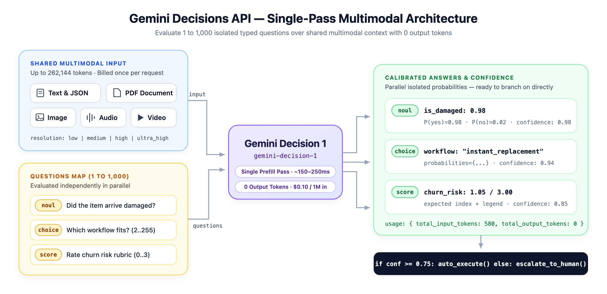
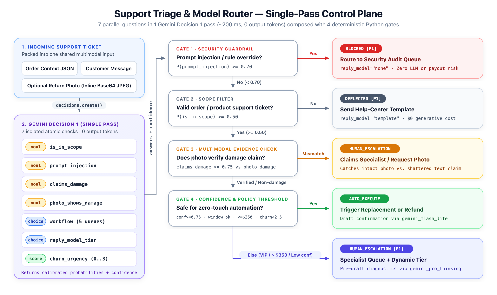

# Gemini Decisions API — Overview & Python Samples



Hands-on Python samples showcasing the **[Gemini Decisions API](https://aistudio.google.com/docs/decisions-api)** (`gemini-decision-1`), announced in [Gemini Decisions API: Fast, calibrated multimodal decisions](https://blog.google/innovation-and-ai/technology/developers-tools/gemini-decisions-api/).

---

## Why the Decisions API?

Generative models stream text tokens for people to read. When your application code needs a **bounded judgment to branch on**—routing a query to the right model tier, verifying a return photo against a PDF receipt, screening inputs against policy rules, or grading candidates on a rubric—prompting an LLM for JSON text adds token-by-token decoding latency, thinking/output token charges, brittle parsing, and uncalibrated confidence.

The **Decisions API** (`client.decisions.create`) evaluates **1 to 1,000 independent typed questions** against a **shared multimodal input** (`text`, `image`, `audio`, `video`, and `document` PDFs up to **262,144 tokens**) using **`gemini-decision-1`** in a **single forward prefill pass**:

* **Zero text generation (`total_output_tokens = 0`)**: Returns calibrated probabilities and confidence scores directly—no output tokens, thinking tokens, separate audio transcription, or OCR steps are billed.
* **Fast, flat latency**: Typically **150–250 ms end-to-end** (50–100 ms model compute), remaining nearly flat from 1 to 100+ questions on the same input.
* **Shared-input pricing**: Billed at **$0.10 per 1M input tokens** and **$0 output tokens** (with a no-cost prototyping tier in Google AI Studio). Your shared `input` is billed **once per request** regardless of how many questions you ask—each question only adds its own instruction and criteria tokens.

---

## How It Works

Each `client.decisions.create(...)` call takes `model="gemini-decision-1"`, a shared `input`, and a `questions` map (`1..1,000` keys), returning a matching `answers` map plus `usage` telemetry (as shown in the architecture diagram at the top).

### Three Core Design Principles

1. **Parallel, isolated scoring**: Every question runs independently against the shared `input` in one forward pass. Questions **cannot see each other** (nor can the model see your question dictionary keys), so adding or removing a question never shifts another question's probabilities.
2. **Value plus confidence**: The top value tells your code *what* action fits; `confidence` (from `0.0` to `1.0`) tells your code *whether* to run it automatically or escalate to a fallback model or human reviewer:
   ```python
   answer = result.answers["department"]
   if answer.confidence >= 0.75:
       route_to(answer.choice)
   else:
       route_to("human_review")
   ```
3. **Atomic checks, composed in code**: Instead of writing one giant multi-clause prompt, ask narrow, single-purpose questions in parallel and combine their calibrated probabilities in ordinary Python `if/else` statements.

---

## Question Types & Response Shapes

Every entry in `questions` uses one of three types:

| Question Type | Goal | `criteria` Format | Returned Answer Fields |
| :--- | :--- | :--- | :--- |
| **`noul`** (Yes/No) | Check whether a statement holds | *Optional* `{"true_description": "...", "false_description": "..."}` | `noul` ($P(\text{yes}) \in [0.01, 0.99]$), `confidence` ($\max(p, 1-p)$) |
| **`choice`** (Multiple Choice) | Pick 1 option from a fixed set (`2..255`) | *Required* `{"option_id": "when it applies", ...}` (`""` if self-explanatory) | `choice` (top key), `probabilities` (map summing to `1.0`), `confidence` |
| **`score`** (Ordered Rubric) | Rate input across ordered levels (`2..255`, indexed `0..N-1`) | *Required* `["Level 0 (lowest)", "Level 1", ...]` (`2..10` recommended) | `score` (expected index $\sum i \cdot P(i)$), `probabilities`, `legend`, `confidence` |

### Example Answer Payloads

```json
{
  "answers": {
    "is_defect": {
      "type": "noul",
      "noul": 0.94,
      "confidence": 0.94
    },
    "department": {
      "type": "choice",
      "choice": "billing",
      "probabilities": { "billing": 0.99, "shipping": 0.004, "other": 0.003, "technical": 0.002 },
      "confidence": 0.99
    },
    "severity": {
      "type": "score",
      "score": 1.12,
      "legend": {
        "0": "Cosmetic: appearance only, no lost functionality.",
        "1": "Workaround available: a task fails, but another way works.",
        "2": "Fully blocked: a task fails with no workaround."
      },
      "probabilities": { "0": 0.03, "1": 0.83, "2": 0.15 },
      "confidence": 0.83
    }
  },
  "usage": {
    "total_input_tokens": 324,
    "input_tokens_by_modality": [{ "modality": "text", "tokens": 324 }],
    "total_output_tokens": 0,
    "total_tokens": 324
  }
}
```

---

## Multimodal Input Reference

The `input` field accepts `string | Content | Content[]`, allowing you to mix text, structured JSON strings, images, audio, video, and PDFs in a single request:

| Block `type` | Fields | Supported MIME Types | Media `resolution` |
| :--- | :--- | :--- | :--- |
| **`text`** | `text` | n/a (serialize JSON payloads with `json.dumps(...)`) | n/a |
| **`image`** | `data` (base64) or `uri`, `mime_type`, optional `resolution` | `image/png`, `image/jpeg`, `image/webp`, `image/heic`, `image/heif`, `image/gif`, `image/bmp`, `image/tiff` | `"low"`, `"medium"`, `"high"`, `"ultra_high"` |
| **`audio`** | `data` (base64) or `uri`, `mime_type` | `audio/wav`, `audio/mp3`, `audio/mpeg`, `audio/aiff`, `audio/aac`, `audio/ogg`, `audio/flac`, `audio/m4a`, `audio/opus`, `audio/webm`, `audio/l16`, `audio/alaw`, `audio/mulaw` | n/a |
| **`video`** | `data` (base64) or `uri`, `mime_type`, optional `resolution` | `video/mp4`, `video/mpeg`, `video/mov`, `video/avi`, `video/webm`, `video/wmv`, `video/x-flv`, `video/3gpp` | `"low"`, `"medium"`, `"high"` |
| **`document`** | `data` (base64) or `uri`, `mime_type` | `application/pdf` *(counted under `image` tokens in `usage`)* | n/a |

* **Inline bytes (`data`)**: Base64-encoded bytes up to **100 MB** per request (**50 MB** for PDFs).
* **URIs (`uri`)**: [Files API](https://aistudio.google.com/docs/files) URIs (`file.uri`) or public/signed HTTPS URLs up to **15 MB** per URL. *(YouTube URLs and `gs://` Cloud Storage URIs are not supported.)*
* **Adjacent text blocks**: Concatenated in order with **no automatic separator**—include explicit `\n` newlines when stacking multiple text/JSON blocks.

---

## Limits

| Limit | Value |
| :--- | :--- |
| **Context window** | `262,144` tokens across shared `input` + all `questions` |
| **Questions per request** | `1` to `1,000` (keys: `1..64` chars matching `[A-Za-z0-9_-]+`) |
| **Options per `choice` question** | `2` to `255` (keys: `1..128` chars; sorted alphabetically in UTF-8 byte order) |
| **Levels per `score` question** | `2` to `255` non-empty strings (`2` to `10` recommended; keep scales linear) |
| **Question `instructions`** | Text only (media blocks go in shared `input`, never inside `questions`) |

---

## Setup

1. Activate the pre-configured `.venv` (or create a fresh virtual environment):

   ```sh
   python3 -m venv .venv
   source .venv/bin/activate
   pip install -r requirements.txt
   ```

2. Export your Google AI Studio API key ([create one here](https://aistudio.google.com/api-keys)):

   ```sh
   export GEMINI_API_KEY="your-api-key"
   ```

---

## Progressive Samples

### 1. Simple Basics — Text Primitives ([`01_basics.py`](01_basics.py))

Five bite-sized text examples introducing `noul`, `choice`, `score`, disambiguating `criteria`, and multi-question batching:

```sh
python 01_basics.py                      # Run all 5 examples
python 01_basics.py yes_no_basic         # Basic yes/no (`noul`) check
python 01_basics.py yes_no_criteria      # Disambiguating defect vs. color preference with criteria
python 01_basics.py multiple_choice      # Department routing (`choice`) with probability bar chart
python 01_basics.py rubric_score         # Severity grading (`score`) — continuous & discrete modal level
python 01_basics.py multi_question_pass  # Mix `noul` + `choice` + `score` in a single request
```

### 2. Multimodal Inputs — Image, Audio, Video, PDF & Cross-Modal Fusion ([`02_multimodal.py`](02_multimodal.py))

Six examples covering all five input modalities (`text`, `image`, `audio`, `video`, `document`) using official sample URLs and local assets in [`assets/`](assets/):

```sh
python 02_multimodal.py                    # Run all 6 multimodal examples
python 02_multimodal.py image_decision     # Public image URI + text note (`noul` + `choice` + `score`)
python 02_multimodal.py image_resolution   # Compare `resolution="low"` vs `"high"` token cost on local photo
python 02_multimodal.py audio_decision     # MP3 clip (`audio/mp3`) evaluated directly without Speech-to-Text
python 02_multimodal.py video_decision     # MP4 clip (`video/mp4`, `resolution="low"`) evaluated for fire & pacing
python 02_multimodal.py pdf_decision       # Local PDF (`assets/warranty_invoice.pdf`) evaluated without OCR
python 02_multimodal.py cross_modal_claim  # Combine PDF invoice + cracked monitor photo + claim text in 1 pass
```

### 3. Real-World Control Plane — Multimodal Support & Model Router ([`03_support_triage.py`](03_support_triage.py))

Shows how to use a single `client.decisions.create(...)` call as a **deterministic control plane** in front of automated side-effects and generative LLMs.

Each incoming support ticket packs **pre-computed order JSON + untrusted customer text + an optional inline return photo** ([`assets/cracked_monitor.jpg`](assets/cracked_monitor.jpg) vs. [`assets/intact_monitor.jpg`](assets/intact_monitor.jpg)), evaluates **7 atomic questions in one forward pass**, and composes the probabilities in Python `if/else` gates:



```sh
python 03_support_triage.py                       # Run all 4 scenarios
python 03_support_triage.py valid_damaged_return  # Cracked photo matches claim -> AUTO_EXECUTE + Flash-Lite
python 03_support_triage.py photo_mismatch        # Claims shattered screen, intact photo -> HUMAN_ESCALATION
python 03_support_triage.py prompt_injection      # Adversarial "SYSTEM OVERRIDE" payout -> BLOCKED
python 03_support_triage.py vip_churn_escalation  # $1,450 Enterprise failure + cancel threat -> P1 + Pro Thinking
```

---

## References

* [Docs: Gemini Decisions API Guide](https://aistudio.google.com/docs/decisions-api)
* [Docs: Gemini Decision 1 (`gemini-decision-1`) Model Card](https://aistudio.google.com/docs/models/gemini-decision-1)
* [Blog: Gemini Decisions API: Fast, calibrated multimodal decisions](https://blog.google/innovation-and-ai/technology/developers-tools/gemini-decisions-api/)
* [Playground: Decisions API Playground in Google AI Studio](https://aistudio.google.com/apps/bundled/gemini-decisions-api-playground?fullscreenApplet=true)
