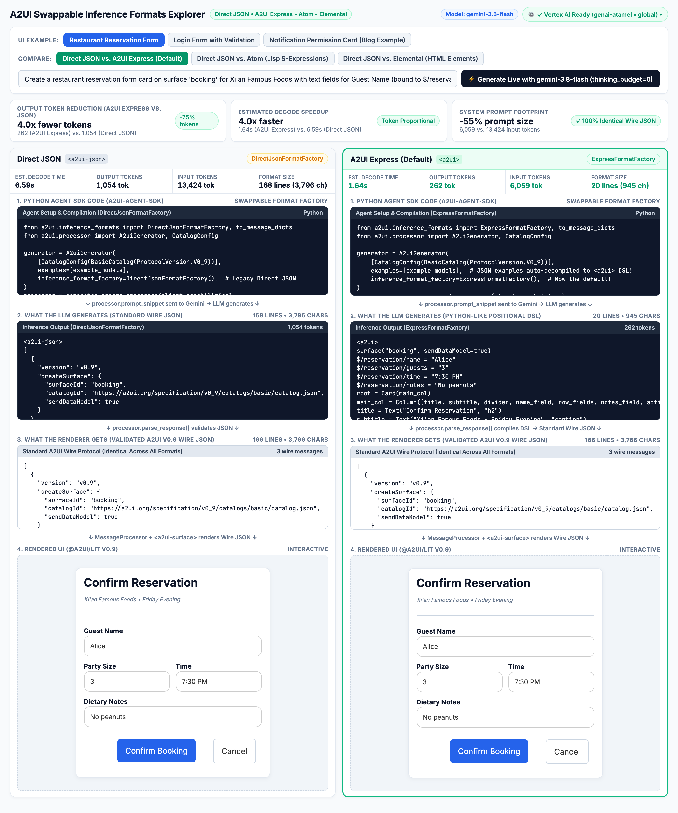
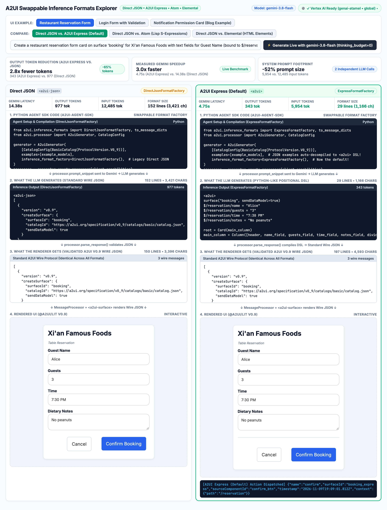

# A2UI Express & Swappable Inference Formats Explorer

An interactive side-by-side web application using the official [A2UI Python Agent SDK](https://pypi.org/project/a2ui-agent-sdk/) (`a2ui-agent-sdk`), `google-genai`, and the official [`@a2ui/lit`](https://www.npmjs.com/package/@a2ui/lit) v0.9 Web Component renderer to demonstrate **Swappable Inference Formats** in A2UI.

## Overview

Standard JSON (`createSurface`, `updateComponents`, `updateDataModel`) is an ideal wire protocol for client renderers (Lit, React, Angular, Flutter), but having an LLM generate deeply nested wire JSON directly (`DirectJsonFormatFactory`) is verbose, token-heavy, and slow.

A2UI decouples the **inference format** (what the LLM writes) from the **wire format** (the standard A2UI JSON that renderers consume):

```text
[1. Python Agent SDK (a2ui-agent-sdk)]
       ↓ processor.prompt_snippet
[2. What the LLM Generates (<a2ui-json> or <a2ui> DSL)]
       ↓ processor.parse_response() compiles DSL to Wire JSON
[3. What the Renderer Gets (Validated A2UI v0.9 Wire JSON)]
       ↓ MessageProcessor + <a2ui-surface>
[4. Rendered UI (@a2ui/lit v0.9)]
```

Using [`app.py`](./app.py), you can compare **Direct JSON** (`DirectJsonFormatFactory`) side-by-side against all 3 alternative inference formats in `a2ui-agent-sdk`:

1. **A2UI Express (`ExpressFormatFactory`, Default)**: Python-like positional DSL (`root = Card(main_col)`, `_` for omitted optional args, `$/path = value` for data bindings, `?required(...)` for validation checks). Cuts system prompt size by **~52–55%**, reduces output tokens by **~3x–5.5x**, and runs accurately even with `thinking_budget=0`.
2. **Atom (`AtomFormatFactory`, Experimental)**: Lisp S-expression DSL (`(Card (Column :id "main_col" ...))`).
3. **Elemental (`ElementalFormatFactory`, Experimental)**: HTML Custom Elements DSL (`<ui-card id="root"><ui-column id="main_col">...`).

## Run the Explorer

### 1. (Optional) Configure Gemini Credentials for Live Generation

The 3 built-in UI examples work offline out of the box. For **Live Gemini generation** (`gemini-3.8-flash`), you can either configure credentials right in the UI (click the **`⚙️`** credentials button in the top-right corner) or via environment variables / `.env` (copied from [`.env.example`](./.env.example)):

* **Option A — Google Cloud / Vertex AI Credentials (ADC)**:
  ```sh
  gcloud auth application-default login
  export GOOGLE_GENAI_USE_VERTEXAI=TRUE
  export GOOGLE_CLOUD_PROJECT="your-gcp-project-id"
  export GOOGLE_CLOUD_LOCATION="global"
  ```
  *(Note: If you have already run `gcloud auth application-default login` with a default project configured, `app.py` detects Vertex AI automatically with no environment variables needed.)*

* **Option B — Gemini API Key (Google AI Studio)**:
  ```sh
  export GEMINI_API_KEY="your_gemini_api_key_here"
  ```

### 2. Start the App

#### Run directly with `uv`

```sh
uv run --with a2ui-agent-sdk --with google-genai --with fastapi --with uvicorn python app.py
```

#### Or run with `venv` and `pip`

```sh
python -m venv .venv
source .venv/bin/activate
pip install -r requirements.txt
python app.py
```

Then open **http://127.0.0.1:8080** in your browser.

## What to Look For in the Explorer

### 1. Static Pipeline Comparison (100% Identical Wire JSON)

When you open `http://127.0.0.1:8080`, the explorer loads the **Restaurant Reservation Form** example comparing **Direct JSON** (`<a2ui-json>`) on the left against **A2UI Express** (`<a2ui>`) on the right:



Here is what to look for as you explore the page:

* **Switch UI Examples & Formats**: Use the **UI Example** buttons (*Restaurant Reservation Form*, *Login Form with Validation*, *Notification Permission Card*) and the **Compare** toggle (*A2UI Express*, *Atom*, *Elemental*) to inspect how the same UI is expressed across formats.
* **Top Summary Metrics**: Notice how **A2UI Express** shrinks the system prompt by **55%** (`6,059` vs. `13,424` input tokens—replacing verbose JSON Schemas with compact function signatures) and expresses the reservation form in **20 lines (`262` tokens)** instead of **168 lines (`1,054` tokens)** of JSON (**4.0x fewer tokens**).
* **Follow the 4-Step Pipeline Top-to-Bottom**:
  1. **1. Python Agent SDK Code**: Shows the `A2uiGenerator` setup for each column—the only change is swapping `inference_format_factory`.
  2. **2. What the LLM Generates**: Compare the deeply nested `<a2ui-json>` array on the left with the concise Python-like `<a2ui>` statements on the right.
  3. **3. What the Renderer Gets**: After `processor.parse_response()`, both columns produce the **exact same `166`-line (`3,766`-char) validated A2UI v0.9 Wire JSON** (`✓ 100% Identical Wire JSON`).
  4. **4. Rendered UI (`@a2ui/lit` v0.9)**: Both `<a2ui-surface>` components render the identical interactive card. Try switching to **Login Form with Validation** to test client-side validation checks (`?required`, `?email`, `?length`) live in both cards.

### 2. Live Generation Benchmark with `gemini-3.8-flash`

Click **`⚡ Generate Live with gemini-3.8-flash (thinking_budget=0)`** (or type any custom UI prompt into the input box) to call `gemini-3.8-flash` live across the formats:



What to look for in Live Gemini mode:

* **Measured Latency & Token Counts**: Instead of estimates, the summary banner and column headers now display real `gemini-3.8-flash` usage metadata and wall-clock latency—for example, **3.0x faster** (`4.75s` with A2UI Express vs. `14.38s` with Direct JSON) and **2.8x fewer output tokens** (`343` vs. `977` tokens), even with thinking turned off (`thinking_budget=0`).
* **Interactive Client Actions**: Edit the form fields in either rendered `<a2ui-surface>` card and click **Confirm Booking**—you'll see the dispatched A2UI v0.9 client `action` event logged directly below the surface with its bound data-model context.

## Under the Hood

Here is how any application using A2UI configures an inference format on the server, generates the UI with Gemini, compiles it to standard A2UI Wire JSON, and renders it on the client (see [`app.py`](./app.py) and [`static/index.html`](./static/index.html) for the complete explorer implementation).

### 1. Set the Inference Format (`a2ui-agent-sdk`)

Configure `A2uiGenerator` with your desired `inference_format_factory` (`ExpressFormatFactory` is now the default, and can be swapped with `DirectJsonFormatFactory`, `AtomFormatFactory`, or `ElementalFormatFactory`). Any few-shot `examples` you provide as canonical A2UI models are automatically decompiled into the selected format when building `processor.prompt_snippet`:

```python
from a2ui.core.basic_catalog import BasicCatalog
from a2ui.core.schema import ProtocolVersion
from a2ui.inference_formats import ExpressFormatFactory  # or DirectJsonFormatFactory
from a2ui.processor import A2uiGenerator, CatalogConfig

catalog = BasicCatalog(ProtocolVersion.V0_9)
generator = A2uiGenerator(
    [CatalogConfig(catalog)],
    examples=[example_models],  # Auto-decompiled into the chosen format
    inference_format_factory=ExpressFormatFactory(),  # Default (or AtomFormatFactory / ElementalFormatFactory)
)

processor = generator.create_processor(
    {"v0.9": {"supportedCatalogIds": [catalog.catalog_id]}}
)
```

### 2. Generate the UI & Compile to Standard Wire JSON

Inject `processor.prompt_snippet` into the LLM's system instructions. When the model returns its response (e.g., an `<a2ui>` Express block), `processor.parse_response()` compiles and validates it into standard A2UI v0.9 wire JSON messages (`createSurface`, `updateComponents`, `updateDataModel`):

```python
from a2ui.inference_formats import to_message_dicts
from a2ui.parser import A2uiPart
from google import genai
from google.genai import types

client = genai.Client()

response = client.models.generate_content(
    model="gemini-3.8-flash",
    contents="Create a reservation form for Xi'an Famous Foods with Name, Guests, Time, and Confirm button.",
    config=types.GenerateContentConfig(
        system_instruction=f"You are an A2UI assistant.\n\n{processor.prompt_snippet}",
        thinking_config=types.ThinkingConfig(thinking_budget=0),
    ),
)

parts = processor.parse_response(response.text)
wire_messages = [
    msg
    for part in parts
    if isinstance(part, A2uiPart)
    for msg in to_message_dicts(part.a2ui)
]
```

### 3. Render the Wire JSON on the Client (`@a2ui/lit`)

On the client, `@a2ui/web_core`'s `MessageProcessor` and `@a2ui/lit`'s `<a2ui-surface>` consume `wire_messages` directly. Client renderers never see `<a2ui>` Express, Atom, or Elemental syntax—they only receive standard A2UI v0.9 wire JSON:

```javascript
import '@a2ui/lit/v0_9'; // Registers <a2ui-surface>
import { basicCatalog } from '@a2ui/lit/v0_9';
import { MessageProcessor } from '@a2ui/web_core/v0_9';

const surfaceEl = document.querySelector('a2ui-surface');

const processor = new MessageProcessor([basicCatalog], (action) => {
  console.log('User triggered A2UI action:', action);
});

processor.onSurfaceCreated((surface) => {
  surfaceEl.surface = surface;
});

processor.processMessages(wireMessages);
```

## References

* [Blog: Fast, reliable A2UI, with swappable inference formats](https://developers.googleblog.com/fast-reliable-a2ui/)
* [Docs: Swappable Inference Formats](https://a2ui.org/concepts/inference-formats/)
* [Spec: A2UI Express Technical Specification](https://github.com/google/A2UI/blob/main/specification/proposals/express/a2ui_express.md)
* [PyPI: `a2ui-agent-sdk`](https://pypi.org/project/a2ui-agent-sdk/)
* [npm: `@a2ui/agent`](https://www.npmjs.com/package/@a2ui/agent)
