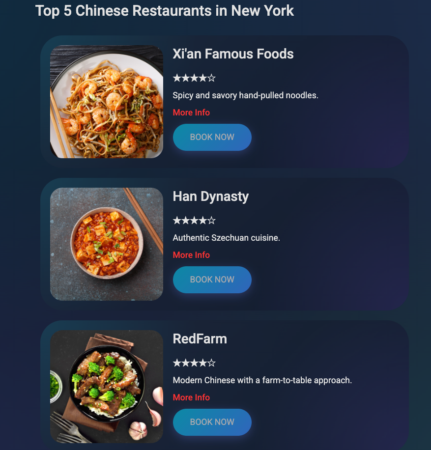

# A2UI with Agent Development Kit (ADK)

Let's look at how you can generate UI with A2UI and ADK agents using the Restaurant Finder sample.

## Before you start

Clone the repository:

```sh
git clone https://github.com/google/a2ui.git
cd a2ui
```

Enable Corepack and install the workspace dependencies with Yarn:

```sh
corepack enable
PUPPETEER_SKIP_DOWNLOAD=true yarn install
```

Set your Gemini API key:

```sh
export GEMINI_API_KEY="your_gemini_api_key_here"
```

Samples have server (agent) and client (renderer) parts that both need to be started. You can find ADK agent
samples in [samples/agent/adk](https://github.com/google/A2UI/tree/main/samples/agent/adk) and client renderers in
[samples/client](https://github.com/google/A2UI/tree/main/samples/client) in the A2UI repo.

## Restaurant Finder app

To run the restaurant finder app, start both the agent and the client servers.

Inside the [`samples/client/lit`](https://github.com/google/A2UI/tree/main/samples/client/lit) folder:

```sh
cd samples/client/lit
yarn demo:restaurant
```

This builds the Lit renderer packages and starts both the agent (`http://localhost:10002`) and the client (`http://localhost:5173`) servers. Navigate to `http://localhost:5173` (or `http://localhost:5173/?app=restaurant`) and start prompting your AI agent. For example `Top 5 Chinese restaurants in New York`:

You should see the UI generated by the agent and rendered on the client side:



If you look into the logs, you should also see the A2UI JSON response:

```json
[
  {
    "version": "v0.9",
    "createSurface": {
      "surfaceId": "default",
      "catalogId": "https://a2ui.org/specification/v0_9/catalogs/basic/catalog.json",
      "theme": {
        "primaryColor": "#FF0000",
        "font": "Roboto"
      }
    }
  },
  {
    "version": "v0.9",
    "updateComponents": {
      "surfaceId": "default",
      "components": [
        {
          "id": "root",
          "component": "Column",
          "children": ["title-heading", "item-list"]
        },
        {
          "id": "title-heading",
          "component": "Text",
          "variant": "h1",
          "text": {
            "path": "/title"
          }
        },
        {
          "id": "item-list",
          "component": "List",
          "direction": "vertical",
          "children": {
            "componentId": "item-card-template",
            "path": "/items"
          }
        }
      ]
    }
  }
]
```

Let's take a look at what's happening under the hood.

On the agent side, you can review the agent code in [`samples/agent/adk/restaurant_finder`](https://github.com/google/A2UI/tree/main/samples/agent/adk/restaurant_finder). Specifically, [`prompt_builder.py`](https://github.com/google/A2UI/blob/main/samples/agent/adk/restaurant_finder/prompt_builder.py) shows how to build the prompt for the agent to generate A2UI responses.

We're instructing the agent to generate A2UI responses using the following prompt:

```python
ROLE_DESCRIPTION = (
    "You are a helpful restaurant finding assistant. Your final output MUST be an A2UI"
    " UI definition."
)

UI_DESCRIPTION = """
-   If the query is for a list of restaurants, use the restaurant data you have already received from the `get_restaurants` tool to populate the `updateDataModel` message.
-   IMPORTANT: When using updateDataModel to update items, you MUST specify `path: "/items"` in `updateDataModel`, and the `value` MUST be an array of restaurants.
-   IMPORTANT: Always specify the path when using updateDataModel. The part message is ignored when the path is missing.
-   If the number of restaurants is 5 or fewer, you MUST use the `SINGLE_COLUMN_LIST_EXAMPLE` template.
-   If the number of restaurants is more than 5, you MUST use the `TWO_COLUMN_LIST_EXAMPLE` template.
-   If the query is to book a restaurant (e.g., "USER_WANTS_TO_BOOK..."), you MUST use the `BOOKING_FORM_EXAMPLE` template.
-   If the query is a booking submission (e.g., "User submitted a booking..."), you MUST use the `CONFIRMATION_EXAMPLE` template.
"""
```

In [`agent.py`](https://github.com/google/A2UI/blob/main/samples/agent/adk/restaurant_finder/agent.py), `A2uiGenerator` and `A2uiRequestProcessor` load component catalogs (`BasicCatalog`) and generate the schema prompt snippet. Then `A2uiInstruction` combines the role description, UI description, few-shot examples, and the A2UI processor prompt snippet for the ADK `LlmAgent`:

```python
examples = load_examples(
    processor.active_catalogs, examples_path, validate=True
)
prompt_parts = [
    ROLE_DESCRIPTION,
    f"## UI Description:\n{UI_DESCRIPTION}",
]
if examples:
    prompt_parts.append(f"### Examples:\n{examples}")

instruction = A2uiInstruction(
    "\n\n".join(prompt_parts),
    a2ui_processor=processor,
)

return LlmAgent(
    model=Gemini(
        model=model_name,
        retry_options=types.HttpRetryOptions(attempts=3, initial_delay=2.0),
    ),
    name="restaurant_agent",
    description="An agent that finds restaurants and helps book tables.",
    instruction=instruction,
    tools=[get_restaurants],
)
```

As the agent generates the response, `stream_response_to_parts` streams A2UI parts to the client and `processor.parse_response` validates the output against the active A2UI catalog schema:

```python
async for part in stream_response_to_parts(
    processor.open_stream(),
    token_stream(),
    version=ui_version,
):
    parts_streamed = True
    yield {
        "is_task_complete": False,
        "parts": [part],
    }

# Validate complete response against schema
response_parts = processor.parse_response(final_response_content)
```

You can see [A2UI - Agent-to-UI for ADK](https://google.github.io/adk-docs/integrations/a2ui/) for more details.

On the client side, you can take a look at the Lit implementation of A2UI in [`typescript/renderers/lit`](https://github.com/google/A2UI/tree/main/typescript/renderers/lit) and the shell client in [`samples/client/lit/shell`](https://github.com/google/A2UI/tree/main/samples/client/lit/shell) which takes the generated JSON and renders it. Other client implementations for the Restaurant Finder sample are also available in [React](https://github.com/google/A2UI/tree/main/samples/client/react/shell), [Angular](https://github.com/google/A2UI/tree/main/samples/client/angular), and [Flutter](https://github.com/google/A2UI/tree/main/samples/client/flutter/restaurant_finder).

## References

* [Quickstart: Run A2UI in 5 Minutes](https://a2ui.org/quickstart)
* [A2UI — Agent-to-UI for ADK](https://google.github.io/adk-docs/integrations/a2ui/)
* [GitHub: A2UI samples](https://github.com/google/A2UI/tree/main/samples)