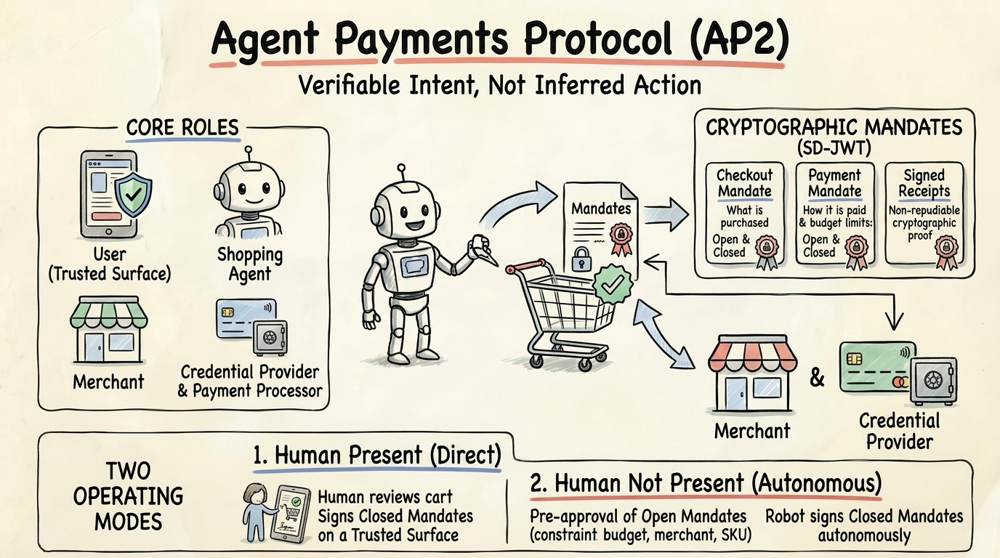
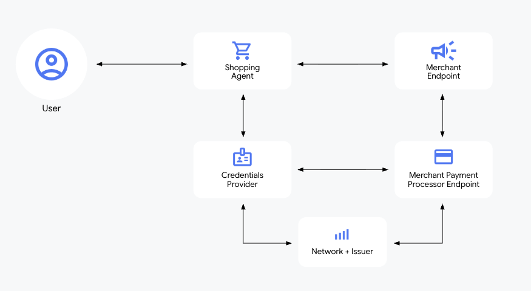
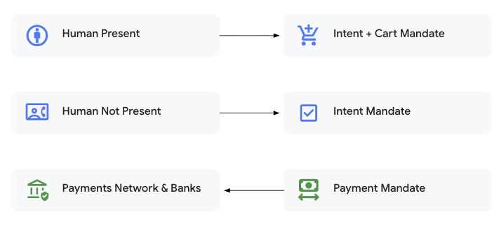
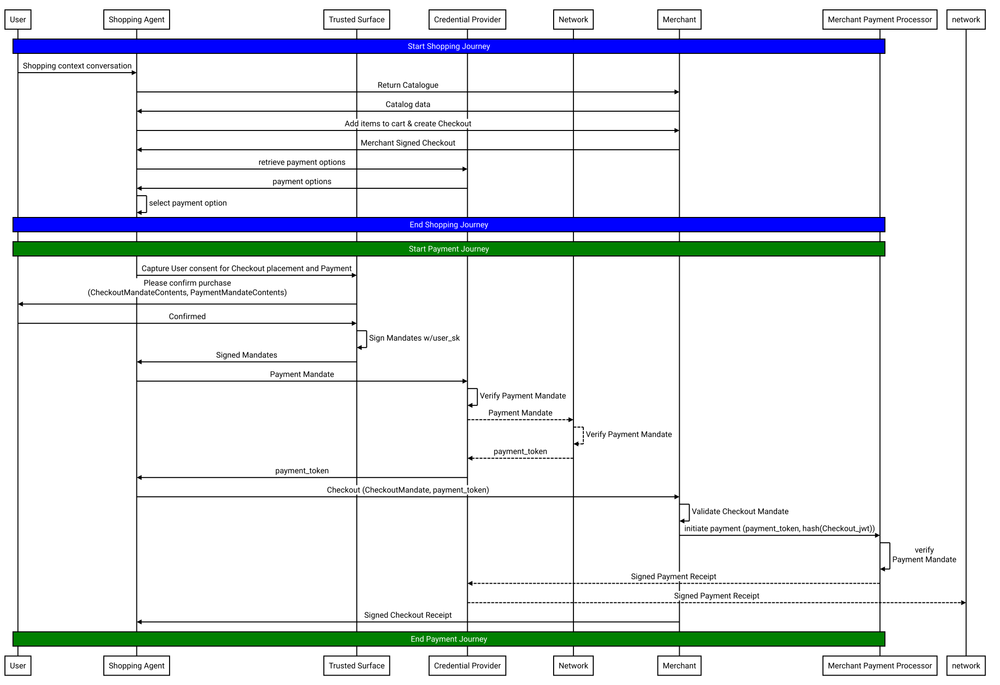
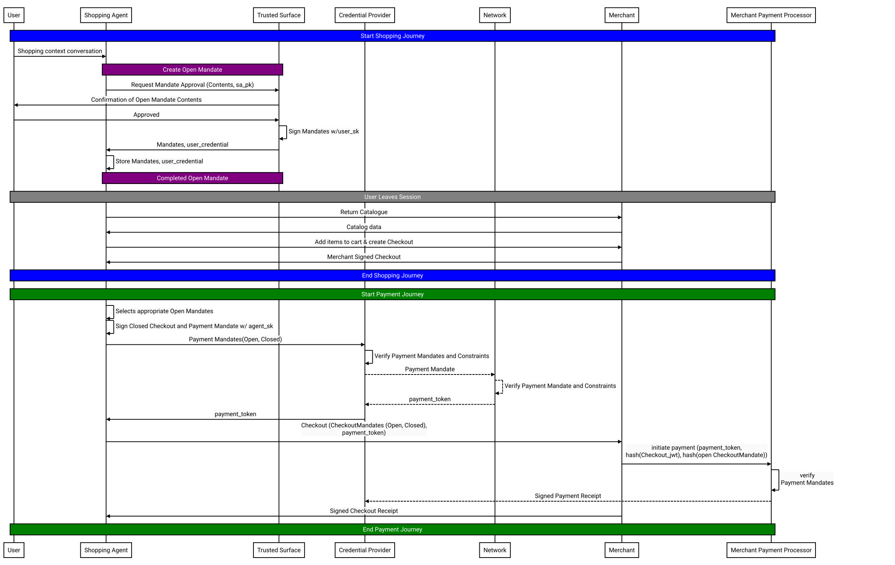

# Agent Payments Protocol (AP2)



[Agent Payments Protocol (AP2)](https://ap2-protocol.org/) is an open protocol, originated by Google, for securing agent-initiated payment transactions. AP2 operates as a security and authorization layer alongside the [Agent2Agent Protocol (A2A)](../a2a/), [Model Context Protocol (MCP)](../mcp/), and [Universal Commerce Protocol (UCP)](https://ucp.dev/).

Traditional payment systems assume a human is directly clicking "Buy" on a trusted interface. Autonomous AI agents break this assumption, raising four core challenges that AP2 addresses:

* **Authorization & Auditability**: What verifiable proof demonstrates that the user granted the agent specific authority to make a particular purchase?
* **Authenticity of Intent**: How can a merchant or payment processor verify that an agent's request accurately reflects the human user's true intent?
* **Agent Errors & Hallucinations**: How does the system protect against agent errors (e.g., misinterpreting a request or hallucinating product details or prices)?
* **Accountability**: If a fraudulent or incorrect transaction occurs, what cryptographic evidence establishes who is responsible?

You can read the [AP2 Specification (v0.2)](https://github.com/google-agentic-commerce/AP2/blob/main/docs/ap2/specification.md) for the full protocol details, or see the summary below.

## Roles

AP2 defines a role-based architecture with distinct verification responsibilities:



* **Shopping Agent (SA)**: The primary agent performing product discovery, building the checkout, and executing the purchase on the user's behalf.
* **Credential Provider (CP)**: The source of payment credentials (e.g., a digital wallet). Responsible for verifying that the agent is authorized to access a payment credential and scoping it appropriately.
* **Merchant (M)**: Provides and completes the checkout. Verifies that the Shopping Agent is authorized to purchase the specific items and signs the Checkout object (inventory, pricing, discounts).
* **Merchant Payment Processor (MPP)**: Processes the payment for the merchant by verifying that the payment credential shared by the Credential Provider is authorized for that specific Checkout instance.
* **Trusted Surface (TS)**: A non-agentic UI surface trusted to display mandate details and obtain informed user authentication (e.g., biometric) and consent before creating a user-signed Mandate.
* **Network and Issuer (NI)**: The payment network and credential issuer (bank/card issuer) that receive agentic transaction signals and authorize settlement.

### Agentic vs. Non-Agentic Trust Boundary

A key rule in the AP2 v0.2 specification is the distinction between **Agentic** (LLM-driven, non-deterministic) and **Non-Agentic** (deterministic code) roles:

* **Expected to be Agentic**: `Shopping Agent`
* **MUST be Non-Agentic**: `Trusted Surface`
* **MAY be Agentic or Non-Agentic**: `Merchant`, `Merchant Payment Processor`, `Credential Provider`

Because an LLM-driven agent is treated as a potential vector for prompt injection or hallucination, **all mandate validation and constraint verification MUST execute in deterministic code**, regardless of whether a role uses an LLM for communication.

## Verifiable Digital Credentials (VDCs): Mandates & Receipts

The core principle of AP2 is **"Verifiable Intent, Not Inferred Action."** Instead of trusting an LLM's text summary, AP2 uses tamper-evident **SD-JWTs (Selective Disclosure JWTs)** and **KB-SD-JWT (Key-Binding SD-JWT) delegation chains**.

### Evolution from v0.1 to v0.2

In early AP2 overviews (v0.1), mandates were described conceptually as three objects: **Intent Mandate**, **Cart Mandate**, and **Payment Mandate**:



In the **AP2 v0.2 specification** (and the official `ap2.sdk` Python package), this model is formalized into **two linked Mandate families**—**Checkout Mandates** (securing *what* is being purchased) and **Payment Mandates** (securing *how* it is paid)—each supporting an **Open** state (replacing `IntentMandate` with typed constraints for autonomous agents) and a **Closed** state (bound to a specific checkout/transaction), paired with signed **Receipts**:

| Credential / Object | Schema (`vct`) | Purpose |
| :--- | :--- | :--- |
| **Open Checkout Mandate** | `mandate.checkout.open.1` | Signed by the User on a Trusted Surface for autonomous (*Human Not Present*) flows. Contains checkout constraints and binds the Shopping Agent's public key (`cnf`). |
| **Closed Checkout Mandate** | `mandate.checkout.1` | Authorizes a specific checkout. Bound to the Merchant-signed `checkout_jwt` (a UCP Checkout object) via `checkout_hash`. |
| **Checkout Receipt** | *(Signed ES256 JWT)* | Returned by the Merchant upon accepting or rejecting the Checkout Mandate, bound via `reference = sha256(closed_checkout_jwt)`. |
| **Open Payment Mandate** | `mandate.payment.open.1` | Signed by the User on a Trusted Surface for autonomous flows. Contains payment constraints (e.g., budget limits, allowed payees) and binds the Agent's key (`cnf`). |
| **Closed Payment Mandate** | `mandate.payment.1` | Authorizes payment for a specific checkout (`transaction_id = checkout_hash`, `payee`, `payment_amount`, `payment_instrument`). |
| **Payment Receipt** | *(Signed ES256 JWT)* | Returned by the Merchant Payment Processor (or Credential Provider) confirming settlement, bound via `reference = sha256(closed_payment_jwt)`. |

### Mandate Delegation Chain (`SD-JWT` $\rightarrow$ `KB-SD-JWT`)

In autonomous flows, the User signs the root **Open Mandate** (`SD-JWT`), embedding the Shopping Agent's public key in the `cnf` (confirmation) claim. When the Shopping Agent finds a matching product, it signs a **Closed Mandate** (`KB-SD-JWT`) using its own private key and appends it to the user's open mandate (`open_sd_jwt~~closed_kb_sd_jwt~`), binding them via `sd_hash`:


### Open Mandate Constraints

When a user delegates a task to an agent, Open Mandates restrict what the agent is allowed to approve using deterministic constraints:

| Mandate Type | Constraint Type | What It Enforces |
| :--- | :--- | :--- |
| **Checkout** | `checkout.allowed_merchants` | Restricts which merchants the agent is allowed to buy from. |
| **Checkout** | `checkout.line_items` | Defines acceptable SKUs/items and quantities (evaluated via maximal flow matching). |
| **Payment** | `payment.amount_range` | Restricts the payment amount to `[min, max]` in a given currency. |
| **Payment** | `payment.allowed_payees` | Restricts which merchant/payee can receive funds. |
| **Payment** | `payment.allowed_payment_instruments` | Restricts which payment instruments (e.g., specific card, UPI, x402 wallet) can be used. |
| **Payment** | `payment.allowed_pisps` | Restricts which Payment Initiation Service Providers can facilitate the payment. |
| **Payment** | `payment.agent_recurrence` & `payment.budget` | Bounds recurring purchases by frequency, max occurrences, and cumulative budget. |
| **Payment** | `payment.reference` & `payment.execution_date` | Binds the open payment mandate to a specific open checkout mandate hash and valid date window. |

## Modes: Human Present vs. Human Not Present

Verifiers (Merchants, Credential Providers, Payment Processors) **always** receive a **Closed Checkout Mandate** and a **Closed Payment Mandate**. The difference between the two modes is *who* signs the closed mandates and *how* they are verified:

### 1. Human Present (`Direct` Flow)

In the **Human Present** flow, the user directly reviews the assembled cart and signs the **Closed Checkout Mandate** and **Closed Payment Mandate** on a Trusted Surface:



1. **Shopping**: The User asks the Shopping Agent to find an item. The Shopping Agent queries the Merchant, assembles a cart, and receives a Merchant-signed `checkout_jwt`.
2. **User Approval**: The Shopping Agent constructs the closed Checkout and Payment Mandate contents and presents them on the **Trusted Surface**. The User authenticates and signs both closed mandates (linked via `checkout_hash`).
3. **Tokenization & Checkout**: The Shopping Agent sends the signed Payment Mandate to the Credential Provider to obtain a scoped `payment_token`, then submits the `payment_token` and Checkout Mandate to the Merchant.
4. **Verification & Receipts**: The Merchant verifies the Checkout Mandate, the Merchant Payment Processor verifies the Payment Mandate inside the token, and both return signed **Checkout** and **Payment Receipts**.

### 2. Human Not Present (`Autonomous` Flow)

In the **Human Not Present** flow, the user pre-authorizes **Open Checkout and Payment Mandates** with constraints (e.g., *"Buy these running shoes as soon as the price drops below \$150"*), and leaves the session. The Shopping Agent later signs the **Closed Mandates** autonomously once the constraints are met:



1. **Pre-Authorization (User Present)**: The Shopping Agent constructs `OpenCheckoutMandate` and `OpenPaymentMandate` with constraints and the agent's public key (`cnf`). The User approves and signs them on the **Trusted Surface**, then leaves the session.
2. **Autonomous Shopping (User Absent)**: When the condition is met (e.g., a price drop or restock), the Shopping Agent requests a signed `checkout_jwt` from the Merchant.
3. **Agent Delegation Signing**: The Shopping Agent signs the **Closed Checkout Mandate** and **Closed Payment Mandate** with its own private key (`agent_sk`), chaining them onto the User's Open Mandates (`KB-SD-JWT`).
4. **Constraint Verification & Receipts**:
   * The Credential Provider and Merchant Payment Processor verify the cryptographic chain *and* deterministically check that the closed payment satisfies all `OpenPaymentMandate` constraints.
   * The Merchant verifies the cryptographic chain *and* checks that the checkout satisfies all `OpenCheckoutMandate` constraints.
   * Signed **Checkout** and **Payment Receipts** are returned.

## Steps

### 1. Run the local Hello World sample

Start with the self-contained Hello World sample in this repository, which uses the official `ap2.sdk` Python package to create, chain, verify, and test constraints on AP2 mandates in a single script (no API keys or multiple servers needed):

* [AP2 Hello World (Python SDK)](./hello-world/)

### 2. Run the official multi-agent A2A / MCP scenarios

The official [`google-agentic-commerce/AP2`](https://github.com/google-agentic-commerce/AP2/tree/main/code/samples/python) repository includes full multi-server reference implementations (Shopping Agent built with ADK, Merchant Agent, Credential Provider, and Payment Processor communicating over A2A and MCP) supporting both **Cards (DPAN)** and **x402 (crypto/stablecoins)**:

```shell
git clone https://github.com/google-agentic-commerce/AP2.git
cd AP2
export GOOGLE_API_KEY="your_google_api_key"

# Human Present (Interactive ADK Web UI) — Cards or x402
./code/samples/python/scenarios/a2a/human-present/cards/run.sh
./code/samples/python/scenarios/a2a/human-present/cards/run.sh --payment-method x402

# Human Not Present (Autonomous price-drop trigger + React Web Client) — Cards or x402
./code/samples/python/scenarios/a2a/human-not-present/cards/run.sh
./code/samples/python/scenarios/a2a/human-not-present/x402/run.sh
```

See the scenario walkthroughs for details:
* [Human Present Purchases with a Card](https://github.com/google-agentic-commerce/AP2/tree/main/code/samples/python/scenarios/a2a/human-present/cards)
* [Human Not Present Purchases with a Card](https://github.com/google-agentic-commerce/AP2/tree/main/code/samples/python/scenarios/a2a/human-not-present/cards)
* [Human Not Present Purchases with x402](https://github.com/google-agentic-commerce/AP2/tree/main/code/samples/python/scenarios/a2a/human-not-present/x402)

## References

* [Official Docs: Agent Payments Protocol (AP2)](https://ap2-protocol.org/)
* [GitHub: google-agentic-commerce/AP2](https://github.com/google-agentic-commerce/AP2)
* [AP2 Specification (v0.2)](https://github.com/google-agentic-commerce/AP2/blob/main/docs/ap2/specification.md)
* [AP2 Python SDK (`code/sdk/python/ap2/sdk`)](https://github.com/google-agentic-commerce/AP2/tree/main/code/sdk/python/ap2/sdk)
---
* [Blog: Announcing Agent Payments Protocol (AP2)](https://cloud.google.com/blog/products/ai-machine-learning/announcing-agents-to-payments-ap2-protocol)
* [Blog: Developer’s Guide to AI Agent Protocols](https://developers.googleblog.com/developers-guide-to-ai-agent-protocols/)
* [Blog: An Illustrated Guide to AP2 (v0.1 concepts)](https://arthurchiao.art/blog/ap2-illustrated-guide/)
---
* [Codelab: Secure Agent Commerce with AP2 and UCP](https://codelabs.developers.google.com/next26/adk-agent-commerce)
* [Codelab: Building Trustworthy Charity Agents with Google ADK and AP2](https://codelabs.developers.google.com/adk-ap2-charity-agents/instructions)
* [YouTube: Intro to Google Agent Payments Protocol (AP2)](https://youtu.be/yLTp3ic2j5c)
* [YouTube: Agent payments, can you do my shopping? | The Agent Factory Podcast](https://youtu.be/T1MtWnEYXM0)
