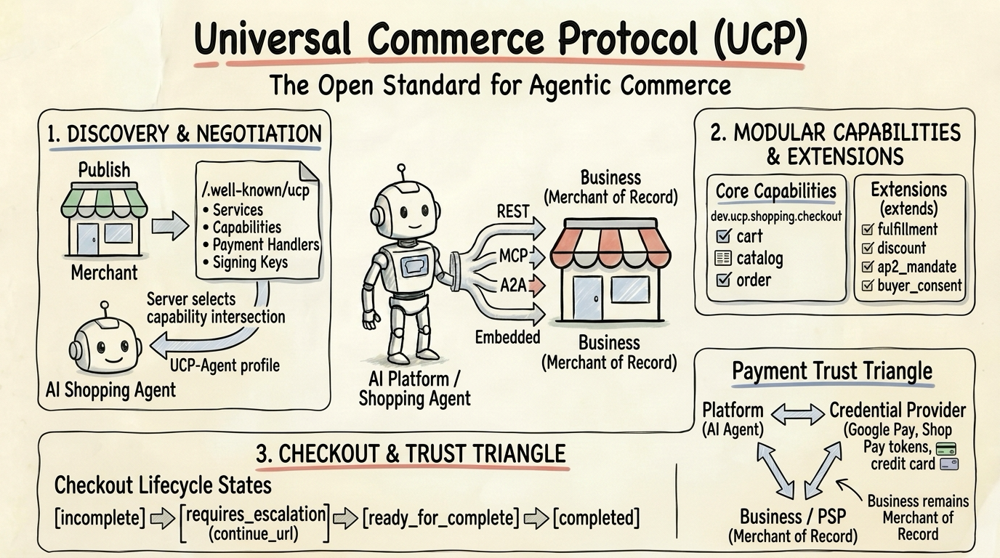
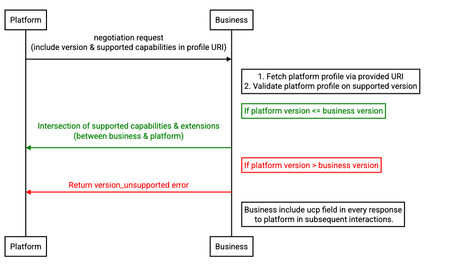
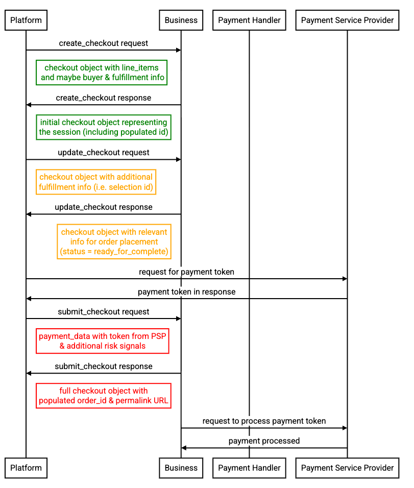
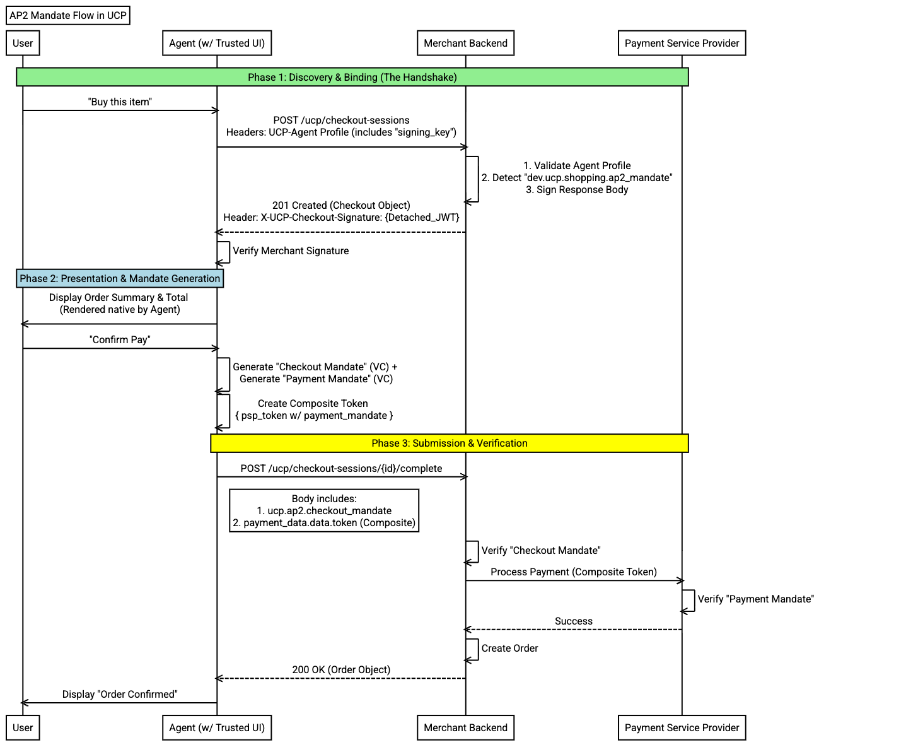

# Universal Commerce Protocol (UCP)



[Universal Commerce Protocol (UCP)](https://ucp.dev/) is an open standard, co-developed by Google, Shopify, and industry partners (including Target, Walmart, Wayfair, Etsy, and Stripe), that defines a common language and functional primitives for **agentic commerce**—enabling AI agents, consumer platforms, businesses, and payment providers to interoperate without bespoke one-off integrations.

You can read [Core Concepts](https://ucp.dev/latest/documentation/core-concepts/) and the [Official Specification](https://ucp.dev/latest/specification/overview/) for full protocol details, or see the summary below.

## High-Level Architecture


UCP is structured around four layers:

* **Services**: Vertical or domain groupings (e.g., `dev.ucp.shopping`, `dev.ucp.common`, `dev.ucp.lodging`).
* **Capabilities**: Discrete, versioned features within a service (e.g., `dev.ucp.shopping.checkout`, `dev.ucp.shopping.cart`, `dev.ucp.shopping.catalog.search`).
* **Extensions**: Optional schemas that augment a parent capability via `extends` (e.g., `dev.ucp.shopping.fulfillment`, `dev.ucp.shopping.discount`, `dev.ucp.common.payment.ap2_mandate`).
* **Transports**: Transport-agnostic bindings supporting **REST** (OpenAPI 3.1), **MCP** (OpenRPC), **A2A** (Agent Card), and **Embedded** (OpenRPC).

## Roles & Participants

UCP defines interactions across four distinct roles:

* **Platform (Application / AI Agent)**: Consumes capabilities exposed by a business on behalf of a user or principal (e.g., AI shopping assistants, search surfaces, procurement agents).
* **Business (Merchant of Record)**: Publishes a UCP profile at `/.well-known/ucp` and exposes commerce capabilities while remaining the **Merchant of Record (MoR)** and retaining ownership of customer relationships.
* **Credential Provider (CP)**: Manages sensitive user payment instruments and shipping addresses, issuing scoped payment tokens (e.g., Google Wallet, Shop Pay) so raw card data never touches the AI platform.
* **Payment Service Provider (PSP)**: Authorizes, captures, and settles funds on behalf of the business (e.g., Stripe, Adyen, PayPal).

## Core Constructs

### Capabilities

Capabilities are the "verbs" of UCP. They use reverse-domain naming (`{reverse-domain}.{service}.{capability}`) so domain owners govern their own namespaces without a central registry, and use date-based snapshot versions (`YYYY-MM-DD`, such as `2026-08-25`):

| Capability | Description |
| :--- | :--- |
| `dev.ucp.shopping.checkout` | Initiates, updates, and completes checkout sessions |
| `dev.ucp.shopping.cart` | Pre-checkout cart creation and management |
| `dev.ucp.shopping.catalog.search` | Searches across a business product catalog |
| `dev.ucp.shopping.catalog.lookup` | Retrieves a specific product or variant by ID |
| `dev.ucp.shopping.order` | Order lifecycle tracking and webhook events |
| `dev.ucp.common.identity_linking` | OAuth 2.0 account linking for loyalty and personalized offers |
| `dev.ucp.lodging.booking` | Hotel and lodging booking sessions |

### Extensions

Extensions compose onto base capabilities via JSON Schema `allOf` using the `extends` field. If a parent capability is not active in a session, any extensions depending on it are automatically pruned:

| Extension | Extends | Description |
| :--- | :--- | :--- |
| `dev.ucp.shopping.fulfillment` | `checkout` | Shipping destinations, delivery methods, and pickup options |
| `dev.ucp.shopping.discount` | `checkout`, `cart` | Promo codes and automatic discounts |
| `dev.ucp.shopping.buyer_consent` | `checkout`, `cart` | Explicit buyer consent capture |
| `dev.ucp.common.loyalty` | `checkout`, `cart`, `catalog` | Loyalty member benefits, rewards, and points |
| `dev.ucp.common.payment.ap2_mandate` | `checkout` | Cryptographic [AP2](../ap2/) mandates for verifiable agent authorization |

## Discovery & Capability Negotiation

Every UCP business publishes an unauthenticated JSON profile at `GET /.well-known/ucp` that advertises its protocol version, service endpoints, capabilities, payment handlers, and ES256 JWK signing keys (`keys[]`).

When a Platform/Agent calls a Business, it advertises its own profile URL in the `UCP-Agent` HTTP header:

```http
POST /checkout-sessions HTTP/1.1
UCP-Agent: profile="https://agent.example.com/.well-known/ucp-agent.json"
```

UCP uses a **server-selects** negotiation model:



1. **Intersect by name**: The Business computes the intersection between its declared capabilities and the Platform's profile.
2. **Select version**: Picks the latest mutually supported `YYYY-MM-DD` version.
3. **Prune orphaned extensions**: Removes any extension whose `extends` parent capability is not in the intersection.

## Checkout Lifecycle & Payment Flow

The `dev.ucp.shopping.checkout` capability progresses through explicit states so an AI agent always knows whether it can complete the purchase autonomously or must hand off to the user:

* `incomplete`: Missing required information (e.g., buyer email or fulfillment address).
* `requires_escalation`: Requires direct buyer input via a `continue_url` handoff (e.g., custom configuration or step-up challenge).
* `ready_for_complete`: All line items, totals, and fulfillment details are finalized; ready for payment submission.
* `completed`: Payment processed and `OrderConfirmation` (`order.id`, `order.permalink_url`) generated.



All monetary amounts in UCP are expressed in **minor currency units (cents)** (e.g., `2500` for `$25.00`, and negative integers like `-400` for a `-$4.00` discount).

## UCP vs. AP2 (How They Work Together)

**UCP** and **[AP2 (Agent Payments Protocol)](../ap2/)** are complementary standards in the agentic commerce stack:

* **UCP** is the **commerce layer**: It standardizes how agents discover stores (`/.well-known/ucp`), browse catalogs, build carts, calculate shipping/discounts, and manage checkout sessions.
* **AP2** is the **cryptographic trust & payment authorization layer**: Through the `dev.ucp.common.payment.ap2_mandate` extension, the Merchant signs the UCP `Checkout` object (`X-UCP-Checkout-Signature`), and the Agent submits cryptographically signed `CheckoutMandate` and `PaymentMandate` Verifiable Credentials (`SD-JWT` / `KB-SD-JWT`) bound to that exact checkout hash.



See [UCP and AP2 Documentation](https://ucp.dev/latest/documentation/ucp-and-ap2/) for full details.

## Steps

Follow these steps to run UCP samples:

1. **[UCP Hello World (Python SDK & FastAPI)](./hello-world/)**: A self-contained FastAPI merchant server (`/.well-known/ucp` + `/checkout-sessions`) and client script using the official `ucp-sdk` package that runs in a single terminal.
2. **[UCP Shopping Agent with Google ADK](./adk/)**: An interactive ADK agent (`adk web`) equipped with UCP discovery and checkout tools backed by `ucp-sdk`.
3. **Official Reference Implementations ([`Universal-Commerce-Protocol/samples`](https://github.com/Universal-Commerce-Protocol/samples))**:
   * [Python FastAPI Flower Shop Server](https://github.com/Universal-Commerce-Protocol/samples/tree/main/rest/python/server) & [Happy Path Client](https://github.com/Universal-Commerce-Protocol/samples/tree/main/rest/python/client/flower_shop) (full SQLite inventory, HTTP Message Signatures, and webhooks)
   * [Node.js Hono & Zod Merchant Server](https://github.com/Universal-Commerce-Protocol/samples/tree/main/rest/nodejs)

## References

* [Official Docs: Universal Commerce Protocol (ucp.dev)](https://ucp.dev/)
* [UCP Core Concepts](https://ucp.dev/latest/documentation/core-concepts/)
* [UCP Official Specification](https://ucp.dev/latest/specification/overview/)
* [UCP and AP2 Integration](https://ucp.dev/latest/documentation/ucp-and-ap2/)
---
* [GitHub: Universal-Commerce-Protocol/ucp (Spec & Schemas)](https://github.com/Universal-Commerce-Protocol/ucp)
* [GitHub: Universal-Commerce-Protocol/python-sdk (`ucp-sdk`)](https://github.com/Universal-Commerce-Protocol/python-sdk)
* [GitHub: Universal-Commerce-Protocol/js-sdk](https://github.com/Universal-Commerce-Protocol/js-sdk)
* [GitHub: Universal-Commerce-Protocol/samples](https://github.com/Universal-Commerce-Protocol/samples)
---
* [Blog: Under the Hood: Universal Commerce Protocol (UCP)](https://developers.googleblog.com/under-the-hood-universal-commerce-protocol-ucp/)
* [Blog: Developer’s Guide to AI Agent Protocols](https://developers.googleblog.com/developers-guide-to-ai-agent-protocols/)
* [Codelab: Secure Agent Commerce with AP2 and UCP](https://codelabs.developers.google.com/next26/adk-agent-commerce)
